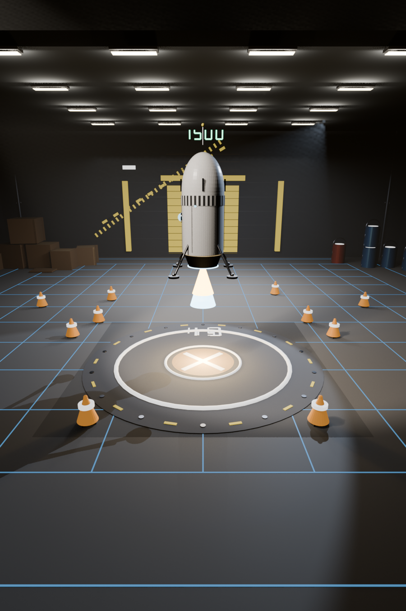

# 🚀 Rocket-Land — Teaching a Rocket to Land Itself

<p align="center">
  
</p>

<p align="center">
  
  
  
  
  
</p>

> A guidance-and-control stack that lands a gimballed rocket on a pad in a 6-DOF physics simulation, built step by step toward flying a real one.

---

## 🎯 Goal

| Phase | Target | Status |
|---|---|---|
| 1 | Perfect the landing policy in simulation | 2D done (99.2%), 3D in progress |
| 2 | Fly a small real rocket | Not started |
| 3 | Fly a 10-foot rocket | Not started |

Full status and history: [`docs/ROADMAP.md`](docs/ROADMAP.md).

---

## ✨ Where it stands: V29

V29 is a **hybrid controller** in a MuJoCo 6-DOF simulation (`src/sim3d/`):

1. **Classical guidance** (`src/sim3d/guidance.py`) flies the rocket using only the 16 sensor values a real vehicle would have. It never sees the true mass, wind or simulator state. It includes a gimbal-aware wind disturbance observer, a position integral and a gust-aware touchdown hold.
2. **A small SAC residual** (`src/train_v29_residual.py`) learns bounded corrections (±10–15% per control) on top of that guidance. With zero output it reproduces the classical controller exactly, so learning can only start from proven behaviour.

The simulation includes wind and gusts, randomized mass / inertia / thrust, engine and gimbal lag, misalignment, fuel burn, a 30% throttle floor, pad tilt, air density variation, 2-step sensor delay, sensor noise and bias, and position-fix dropouts.

| Result (held-out seeds 90000–90999, every factor on) | Precise landings |
|---|---|
| Classical guidance | **91.7%** |
| Calm wind only | 98.8% |
| Wind ≥ 3 m/s | 78.6% |
| Clean conditions (200 eps) | 100% |

The remaining failures come from **gusty strong wind**, not from sensing (perfect sensors add only about 3 points). The residual's first 2M-step run regressed and was fixed in `d4d0677`; a fresh run is the next step.

V28, a from-scratch SAC policy in the same 3D world, learned to hover instead of land and was abandoned. That is why V29 keeps classical guidance in charge.

---

## 🚀 Quick start (Windows, NVIDIA GPU)

```powershell
scripts\setup_v29.bat          # creates .venv, installs CUDA PyTorch, MuJoCo 4.0.1,
                               # Gymnasium 1.4.0, SB3 2.9.2, then runs the tests
scripts\train_v29.bat fresh    # train the residual from scratch (re-run without
                               # "fresh" to resume; Ctrl+C saves first)
scripts\audit_v29.bat          # held-out audit: classical vs. best residual, 1000 eps
```

Or on Colab: [`notebooks/v29_colab.ipynb`](notebooks/v29_colab.ipynb) (setup → classical audit → train → residual audit, outputs on Google Drive).

Run the tests and a single evaluation by hand:

```powershell
python -m unittest discover -s tests -v
python src/evaluate_v29.py --episodes 200 --difficulty 1 --delay 2 --noise --out logs/v29_full.csv
```

More on the V29 interfaces and how to read results: [`docs/V29.md`](docs/V29.md).

### Seed rules

Seeds are split so no result is tuned on the episodes it is judged by:

| Use | Seeds |
|---|---|
| Development | 30000+ |
| Checkpoint selection | 50000–50199 |
| Held-out audit | 90000–90999 |
| Training | 1,000,000+ |

---

## 📁 Repository layout

```
Rocket-Land/
├── src/
│   ├── sim3d/              # V28/V29 MuJoCo env, mission rules, guidance, residual wrapper
│   ├── train_v29_residual.py
│   ├── evaluate_v29.py
│   └── ...                 # 2D LunarLander training / evaluation history (V1–V27)
├── tests/test_v29.py       # V29 unit tests
├── scripts/                # Windows setup / train / audit for V29
├── notebooks/              # Colab notebooks (V27, V28, V29)
├── docs/                   # ROADMAP, V29 notes, results, parameter-gap PDF, design specs
├── models/                 # run manifests (JSON); checkpoints are local only, not in git
├── simulator/              # 2D live Blender viewer (HTTP backend + recorder)
├── blender/                # scenes, previews, rendered episode video
├── research/               # reference papers
└── presentation/
```

Model checkpoints (`models/*.zip`, `*.pkl`) are ignored by git. Training writes them locally or to Google Drive, and each run's `*_manifest.json` (SHA-256, settings, scores) is the record kept in the repo.

---

## 📜 History: Phase 1 in 2D

Before 3D, the project worked through Gymnasium's `LunarLander-v3`: a PPO curriculum (V1–V17) with randomized spawns, gravity, wind, pad position and thrust, then SAC with a tuned reward recipe (V19–V25), ending with **V27** (8-frame stack, [512, 512] network, 8M steps on Colab) at **99.2% precise landings**. The 2D policy can be replayed live in Blender; see [`simulator/README.md`](simulator/README.md).

---

<p align="center">
  <sub>Built with 🤍 and a lot of crashed rockets.</sub>
</p>
